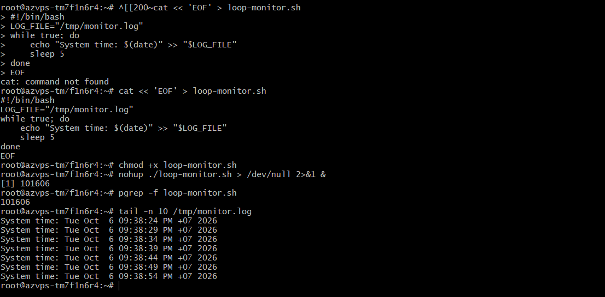
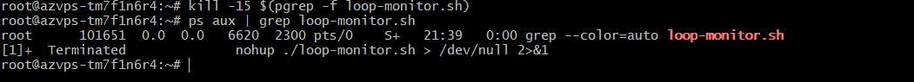

# Báo Cáo Bài Tập 4 (Session 06): Quản Lý Tiến Trình Nền Với Nohup Và Tín Hiệu Kill

- **Khóa học:** IT209 - DevOps
- **Họ và tên:** Nguyễn Tiến Thành
- **Mã số sinh viên (MSSV):** B24DTCN283
- **Email:** thenngk6@gmail.com
- **GitHub Username:** ThanhDZsudo
- **Đường dẫn nộp bài dự kiến:** `homework/session_06/ex4/`

---

## 1. Mục Tiêu Bài Tập
- Làm chủ kỹ thuật khởi chạy các tiến trình chạy ngầm (**Background Process**) độc lập với phiên làm việc Terminal bằng lệnh `nohup` kết hợp toán tử `&`.
- Sử dụng thành thạo các công cụ giám sát tiến trình hệ thống trong Linux (`ps aux`, `pgrep`, `top`/`htop`).
- Hiểu sâu sắc cơ chế hoạt động của các tín hiệu hệ thống (**Linux Signals**) và áp dụng quy trình tắt tiến trình an toàn (**Graceful Shutdown**) bằng lệnh `kill -15` (SIGTERM), dự phòng `kill -9` (SIGKILL).

---

## 2. Bối Cảnh & Ràng Buộc Kỹ Thuật

- **Bối cảnh:** Cần duy trì một kịch bản giám sát hệ thống viết bằng Shell Script (`loop-monitor.sh`) hoạt động liên tục 24/7 trên máy chủ Cloud VPS. Tiến trình phải tiếp tục chạy ngầm ổn định ngay cả khi lập trình viên ngắt kết nối SSH hoặc đóng cửa sổ Terminal. Khi cần bảo trì, phải xác định đúng PID và tắt tiến trình an toàn.
- **Ràng buộc:**
  1. Viết script `loop-monitor.sh` ghi mốc thời gian hiện tại vào `/tmp/monitor.log` định kỳ mỗi 5 giây bằng vòng lặp `while true` và lệnh `sleep`.
  2. Cấp quyền thực thi (`chmod +x`) và chạy ngầm độc lập bằng `nohup`.
  3. Tìm chính xác số định danh tiến trình (**Process ID - PID**).
  4. Bắt buộc ưu tiên tắt tiến trình bằng tín hiệu an toàn **SIGTERM (15)** trước; chỉ sử dụng **SIGKILL (9)** nếu tiến trình bị treo.

---

## 3. Mã Nguồn Kịch Bản Giám Sát (`loop-monitor.sh`)

```bash
#!/bin/bash
# ==============================================================
# Script: loop-monitor.sh
# Muc dich: Ghi thoi gian he thong vao /tmp/monitor.log moi 5 giay
# Khoa hoc: IT209 - DevOps (Session 06 - Bai 4)
# Sinh vien: Nguyen Tien Thanh - MSSV: B24DTCN283
# ==============================================================

LOG_FILE="/tmp/monitor.log"

while true; do
    echo "System time: $(date)" >> "$LOG_FILE"
    sleep 5
done
```

---

## 4. Các Bước Thực Hiện Chi Tiết

### Bước 1: Tạo kịch bản và phân quyền thực thi
Tạo tệp `loop-monitor.sh` trên VPS và cấp quyền thực thi cho chủ sở hữu:
```bash
chmod +x loop-monitor.sh
```

---

### Bước 2: Khởi chạy tiến trình chạy ngầm độc lập với `nohup`
Thực thi script dưới dạng tiến trình nền độc lập:
```bash
nohup ./loop-monitor.sh > /dev/null 2>&1 &
```

**Giải thích chi tiết các thành phần trong câu lệnh:**
- **`nohup`** *(No Hang Up)*: Ngăn hệ điều hành gửi tín hiệu `SIGHUP` (Signal Hangup) đến tiến trình khi phiên làm việc Terminal kết thúc hoặc ngắt kết nối SSH.
- **`./loop-monitor.sh`**: Đường dẫn tệp kịch bản cần thực thi.
- **`> /dev/null`**: Chuyển hướng luồng đầu ra tiêu chuẩn (*stdout - file descriptor 1*) vào thiết bị rỗng `/dev/null` để tránh tạo tệp log mặc định `nohup.out`.
- **`2>&1`**: Chuyển hướng luồng lỗi tiêu chuẩn (*stderr - file descriptor 2*) vào cùng vị trí với luồng tiêu chuẩn (*stdout*).
- **`&`**: Đưa tiến trình xuống chạy dưới nền (*Background Job*), giải phóng ngay cửa sổ Terminal để người dùng tiếp tục thao tác các lệnh khác.

---

### Bước 3: Tìm số định danh tiến trình (PID)
Sử dụng các công cụ tra cứu tiến trình Linux:
```bash
# Cách 1: Sử dụng pgrep tìm nhanh PID
pgrep -f loop-monitor.sh

# Cách 2: Sử dụng ps aux để xem chi tiết đầy đủ thông tin tiến trình
ps aux | grep loop-monitor.sh
```

**Kết quả hiển thị mẫu:**
```text
root       101606  0.0  0.1  13248  3120 ?        S    14:26   0:00 /bin/bash ./loop-monitor.sh
root       14265  0.0  0.0   6432   720 pts/0    S+   14:26   0:00 grep --color=auto loop-monitor.sh
```
> **Xác định:** Số PID của tiến trình là **`101606`** (cột thứ 2). Cột `TTY` mang dấu `?` biểu thị tiến trình đã tách rời hoàn toàn khỏi cửa sổ điều khiển Terminal.

---

### Bước 4: Kiểm tra dữ liệu log ghi nhận liên tục
Sử dụng lệnh `tail` để kiểm tra các dòng log mới nhất đang được ghi đều đặn mỗi 5 giây vào `/tmp/monitor.log`:
```bash
tail -n 10 /tmp/monitor.log
```

**Kết quả ghi log thực tế:**
```text
System time: Tue Oct  6 09:38:24 PM +07 2026
System time: Tue Oct  6 09:38:29 PM +07 2026
System time: Tue Oct  6 09:38:34 PM +07 2026
System time: Tue Oct  6 09:38:39 PM +07 2026
System time: Tue Oct  6 09:38:44 PM +07 2026
System time: Tue Oct  6 09:38:49 PM +07 2026
System time: Tue Oct  6 09:38:54 PM +07 2026
```
*(Có thể dùng `tail -f /tmp/monitor.log` để xem dòng log tự động xuất hiện theo thời gian thực).*

---

### Bước 5: Kiểm tra tính độc lập của tiến trình
1. Đóng hoàn toàn cửa sổ Terminal / Thoát SSH (`exit`).
2. Mở cửa sổ mới và SSH lại vào VPS:
   ```bash
   ps aux | grep loop-monitor.sh
   tail -n 5 /tmp/monitor.log
   ```
> **Kết luận:** Tiến trình vẫn duy trì hoạt động liên tục, các mốc thời gian trong `/tmp/monitor.log` không hề bị gián đoạn.

---

### Bước 6: Tắt tiến trình an toàn bằng tín hiệu SIGTERM (15)
Gửi tín hiệu yêu cầu dừng tiến trình một cách lịch sự:
```bash
kill -15 101606
# (Thay 101606 bằng PID thực tế của bạn)
```

---

### Bước 7: Xác nhận tiến trình đã kết thúc hoàn toàn
Kiểm tra lại danh sách tiến trình:
```bash
ps aux | grep loop-monitor.sh
```
**Kết quả thực thi:**
```text
root      101651  0.0  0.0   6620  2300 pts/0    S+   21:39   0:00 grep --color=auto loop-monitor.sh
[1]+  Terminated              nohup ./loop-monitor.sh > /dev/null 2>&1
```
> **Kết quả mong đợi:** Tiến trình `loop-monitor.sh` đã biến mất hoàn toàn khỏi hệ thống (chỉ còn lại lệnh `grep` tìm kiếm tức thời).

---

## 5. Kết Quả Kiểm Tra Và Bằng Chứng Thực Thi (Verification)

### 5.1. Khởi chạy và kiểm tra PID
```bash
nohup ./loop-monitor.sh > /dev/null 2>&1 &
pgrep -f loop-monitor.sh
# Output: 101606
```

### 5.2. Nội dung file log `/tmp/monitor.log`
```bash
tail -n 5 /tmp/monitor.log
# Output:
# System time: Tue Oct  6 14:26:40 +07 2026
# System time: Tue Oct  6 14:26:45 +07 2026
# System time: Tue Oct  6 14:26:50 +07 2026
# System time: Tue Oct  6 14:26:55 +07 2026
# System time: Tue Oct  6 14:27:00 +07 2026
```

### 5.3. Tắt tiến trình với SIGTERM
```bash
kill -15 101606
ps aux | grep loop-monitor.sh
# Output: Tiến trình đã dừng hoàn toàn.
```

### 5.4. Hình ảnh chụp màn hình minh chứng:



---

## 6. Phân Tích Kỹ Thuật & Best Practices Trong DevOps

### 6.1. Bảng so sánh các tín hiệu Signal phổ biến trong Linux

| Tín hiệu (Signal) | Mã số | Mục đích & Cơ chế hoạt động | Có thể can thiệp (Catch/Trap) không? |
| :--- | :---: | :--- | :---: |
| **SIGHUP** | `1` | Gửi khi Terminal bị đóng hoặc mất kết nối mạng. | Có (Tiến trình có thể bắt để reload config). |
| **SIGINT** | `2` | Gửi khi nhấn tổ hợp phím `Ctrl + C` trên bàn phím. | Có. |
| **SIGTERM** | `15` | **Tín hiệu chấm dứt mặc định**; yêu cầu tiến trình tự dọn dẹp tài nguyên (đóng file, ngắt kết nối DB) trước khi thoát (**Graceful Shutdown**). | **Có** (Khuyên dùng trước tiên). |
| **SIGKILL** | `9` | **Hạ gục tiến trình ngay lập tức** do nhân Linux cưỡng chế ép dừng; tiến trình không có cơ hội dọn dẹp bộ nhớ. | **KHÔNG** (Dùng làm phương án cuối cùng). |

### 6.2. Tại sao luôn dùng `kill -15` trước khi dùng `kill -9`?
- Lệnh `kill -15` (SIGTERM) cho phép ứng dụng thực hiện quy trình đóng an toàn: lưu các transaction đang dở dang, giải phóng bộ nhớ tạm, giải phóng file lock và đóng kết nối cơ sở dữ liệu.
- Nếu lạm dụng `kill -9` (SIGKILL) ngay lập tức, tiến trình bị ngắt đột ngột có thể làm **hỏng tệp tin (corrupted files)**, rò rỉ dữ liệu hoặc khóa cổng mạng không được giải phóng kịp thời.

### 6.3. Giải pháp quản lý tiến trình trong môi trường Production
Mặc dù `nohup ... &` rất tiện lợi cho các tác vụ ngắn hạn hoặc kiểm thử, trong môi trường DevOps Production chuyên nghiệp, kỹ sư sẽ sử dụng:
1. **Systemd Service (`systemctl`):** Tự động khởi động cùng hệ thống, tự động restart khi gặp lỗi crash, quản lý log tập trung với `journalctl`.
2. **Process Manager (Supervisor, PM2):** Tự động giám sát tài nguyên CPU/RAM, cluster mode.
3. **Containerization (Docker / Kubernetes):** Đóng gói ứng dụng vào container độc lập và quản lý vòng đời tự động.